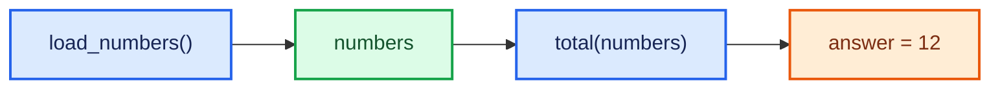
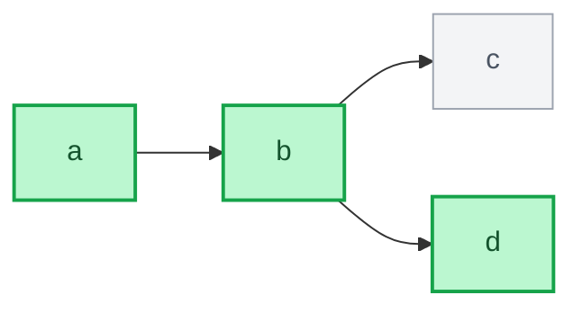
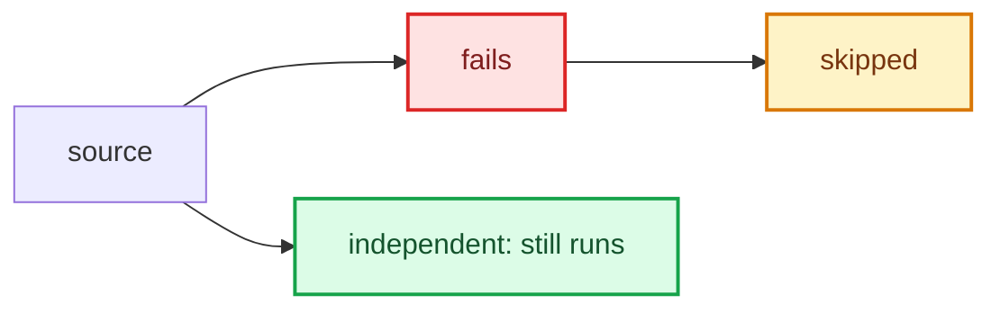

<div align="center">

<h1>lightweight-dag</h1>

<p><strong>Small graphs. Zero orchestration overhead.</strong></p>

<p>
  
  
  
</p>

<p>Define a dependency graph, run ordinary Python functions, keep the results.</p>

</div>

No scheduler to deploy. No database to babysit. Just an in-process DAG runner
for Python workflows that need dependencies, not a whole platform.

## ✨ The shape of it



<p align="center"><b>Write functions → describe dependencies → run only what you need</b></p>

## 🧭 Jump in

| | |
| :-- | :-- |
| [Quick start](#-quick-start) | Define a YAML graph and execute it |
| [Results](#-read-the-results) | Success, failure, and skipped outcomes |
| [Execution controls](#-shape-the-run) | Select outputs, seed values, inspect the plan |
| [Scopes](#-keep-operations-in-their-lane) | Register operations for named DAGs |
| [Configuration](#-choose-your-config-style) | YAML, JSON, or Python `Node` objects |

## 🚀 Quick start

Install with uv:

```bash
uv add lightweight-dag
```

First, save this graph as [`examples/numbers.yaml`](examples/numbers.yaml):

```yaml
nodes:
  - node_id: numbers
    operation: load_numbers
  - node_id: answer
    operation: total
    inputs: [numbers]
```

Register the operations, read the file by path, and run the output:

```python
from pathlib import Path

from lightweight_dag import Dag, dag_node


@dag_node
def load_numbers():
    return [2, 4, 6]


@dag_node
def total(numbers):
    return sum(numbers)


dag = Dag.from_yaml(Path("examples/numbers.yaml").read_text())
result = dag.run(outputs=["answer"])

assert result.status is True
assert result.results["answer"].value == 12
```

> [!TIP]
> A node input named `numbers` receives the value produced by the node whose ID
> is `numbers`. Values are passed to operations as keyword arguments.

## 🎛️ Read the results

Every selected node gets one result object. Its concrete type tells you what
happened; the run itself exposes a boolean `status`.

| Outcome | Object | Read this |
| :-- | :-- | :-- |
| ✅ Done | `SuccessfulNodeExecutionResult` | `.value` |
| ❌ Failed | `ErrorNodeExecutionResult` | `.error` |
| ⏭️ Not run | `SkippedNodeExecutionResult` | No value or exception |

```python
from lightweight_dag import SuccessfulNodeExecutionResult

outcome = result.results["answer"]
if isinstance(outcome, SuccessfulNodeExecutionResult):
    print(outcome.value)
```

The result map is keyed by node ID. A successful function may return `None` and
still produce a successful outcome. The base `NodeExecutionResult` also has a
legacy `.result` boolean, true only for success; the concrete type is the
recommended discriminator.

## 🧩 Shape the run

### Only run the path you need

`outputs` selects those nodes and their dependencies. Shared dependencies run
once; unrelated branches stay untouched. Omit `outputs` to run every node, or
pass `outputs=[]` to run none.



Requesting `outputs=["d"]` runs `a`, `b`, and `d`; `c` is skipped because it
isn't on the selected path.

### Bring values in

`run()` keyword arguments can provide external inputs declared in `Node.inputs`
or seed a node by ID. Seeding an intermediate node skips it and its ancestors;
downstream nodes still run with the supplied value.

```python
# For a graph with eligible_orders -> summary:
report = dag.run(
    eligible_orders=[{"total": 60}, {"total": 80}],
    outputs=["summary"],
)
```

External input names are not node IDs. For example, a node can declare
`inputs=["subtotal", "rate"]`; then call `dag.run(subtotal=100, rate=0.2, ...)`.
`Node.params` supplies fixed string or numeric keyword arguments from the DAG
configuration.

### Preview before running

`explain()` returns a `DagExecutionPlan` without calling any operation:

```python
plan = dag.explain(outputs=["answer"], numbers=[3, 5])

plan.execution_order          # selected nodes in execution order
plan.required_external_inputs # inputs needed by this path
plan.missing_external_inputs  # required inputs not supplied
plan.seeded_nodes             # nodes supplied directly
```

Graph inspection is available too:

```python
dag.dependencies("answer")    # direct inputs, including external names
dag.descendants("numbers")     # transitive dependents
dag.topological_order()         # full deterministic order
```

These methods return tuples and raise `ValueError` for unknown node IDs.

### Stream outcomes

Pass `listeners` to receive each result as its node finishes. Listeners receive
the same objects stored in `DagExecutionResult.results`, in execution order:

```python
def log_result(outcome):
    print(outcome.node_id, type(outcome).__name__)


dag.run(outputs=["answer"], listeners=[log_result])
```

Listeners also receive seeded and skipped outcomes. Exceptions raised by a
listener propagate to the caller.

## 🛟 Failure behavior

By default, a failed node is recorded and its dependents are skipped. Independent
requested branches keep running, so useful partial results survive.



Set `fail_fast=True` to notify listeners of the failure, then immediately
re-raise the original exception. No `DagExecutionResult` is returned in that
mode.

## 🔎 Keep operations in their lane

Global operations are visible to unnamed DAGs. A named DAG sees only operations
registered for exactly that name; there is no fallback to global operations.

```python
@dag_node(dag_name="sales_report")
def load_orders():
    return [{"total": 120}]
```

`load_orders` is available to `sales_report`, not to an unnamed DAG or a DAG
with another name. To choose a separate operation ID, use
`@dag_node("sales_report", "read_orders")`.

`DagSuite` groups named DAGs. Register operations in the matching scope, then
build a suite from a Python mapping:

```python
from lightweight_dag import DagSuite, dag_node


@dag_node("sales_report", "load_orders")
def load_sales_orders():
    return [{"total": 120}]


suite = DagSuite.from_dict(
    {
        "sales_report": {
            "nodes": [{"node_id": "orders", "operation": "load_orders"}]
        }
    }
)
assert suite["sales_report"].run().results["orders"].value == [{"total": 120}]
```

To load [`examples/dags.yaml`](examples/dags.yaml), register every configured
operation in its matching scope, then pass `Path("examples/dags.yaml").read_text()`
to `DagSuite.from_yaml()`. The YAML mapping key supplies the DAG name and must
match any explicit `name` in its definition.

## 🗂️ Choose your config style

### YAML file

`Dag.from_yaml()` accepts YAML text. Read a file with `Path.read_text()` as in
the quick start. `to_dict()` returns a plain configuration dictionary and
omits fields that were not set, so the configuration round-trips without
injecting defaults:

```python
from pathlib import Path

dag = Dag.from_yaml(Path("examples/numbers.yaml").read_text())
assert dag.to_dict() == {
    "nodes": [
        {"node_id": "numbers", "operation": "load_numbers"},
        {"node_id": "answer", "operation": "total", "inputs": ["numbers"]},
    ]
}
```

### JSON text

Pass JSON text directly to Pydantic's `Dag.model_validate_json()`:

```python
json_config = '{"nodes": [{"node_id": "numbers", "operation": "load_numbers"}]}'
dag = Dag.model_validate_json(json_config)
```

If JSON is already parsed into a Python dictionary, use `Dag.from_dict(data)`.

### Python objects

For a graph assembled in code, pass `Node` instances directly to `Dag`:

```python
from lightweight_dag import Dag, Node

dag = Dag(
    nodes=[
        Node(node_id="numbers", operation="load_numbers"),
        Node(node_id="answer", operation="total", inputs=["numbers"]),
    ]
)
```

YAML comments and formatting aren't retained by `to_dict()`. Configuration
serialization does not include registered functions or runtime values.

## 🧪 Extra checks

Opt into static producer/consumer annotation compatibility checks before any
selected operation runs:

```python
result = dag.run(outputs=["answer"], validate_types=True)
```

Common classes, unions, and parameterized generics are checked. Missing
annotations, `Any`, and unfamiliar typing forms are handled conservatively.
This is not runtime type enforcement.

Configuration is validated before execution:

| Problem | What happens |
| :-- | :-- |
| Duplicate node IDs or cycles | DAG construction fails |
| Unknown operation in this scope | DAG construction fails |
| Missing external input | `ValueError` |
| Undeclared `run()` keyword | `ValueError` |
| Invalid operation arguments | Rejected before selected operations run |
| Duplicate YAML mapping key | YAML loading fails |

Only load and run YAML from trusted sources: a config chooses which registered
Python functions execute. When a node input and a parameter have the same name,
the computed input takes precedence.

## 📦 Scope

`lightweight-dag` is a synchronous, in-process DAG runner. It does not include
parallel scheduling, retries, timeouts, persistent caching, distributed
execution, visualization, or DAG composition. Composition needs explicit rules
for external input/output mapping and node-ID conflicts, so it stays out of the
API for now.

For development:

```bash
uv sync --group dev
uv run pytest
uv build
```
