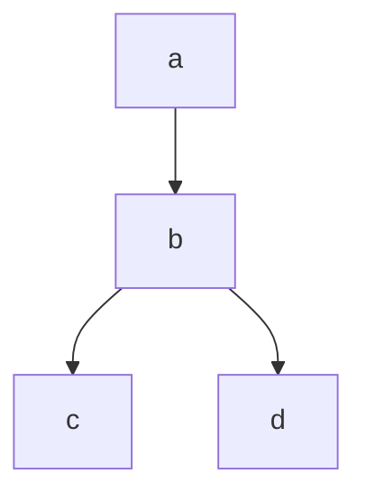

# lightweight-dag

Python library for defining, validating, and executing directed acyclic graphs
(DAGs). Operations are registered Python functions. DAGs can be loaded from
YAML or dictionaries, grouped into named suites, and executed for only the
requested outputs.

Requires Python 3.11 or later.

## Installation

Install the library from the repository:

```bash
pip install .
```

To install the development and test dependencies:

```bash
uv sync --group dev
```

The public API is available from the package root:

```python
from lightweight_dag import Dag, DagExecutionResult, DagSuite, Node, dag_node
```

## Registering operations

Operations must be synchronous functions defined at module level. Passing one
argument to the decorator registers a global operation:

```python
from lightweight_dag import dag_node


@dag_node("normalize")
def normalize(values):
    return [value.strip().lower() for value in values]
```

Passing two arguments registers an operation for a specific DAG:

```python
from lightweight_dag import dag_node


@dag_node("example_report", "filter_orders")
def filter_monthly_orders(orders, minimum_total):
    return [order for order in orders if order["total"] >= minimum_total]
```

A DAG without `name` looks up only global operations. A named DAG looks up only
operations registered for that name; there is no fallback to the global scope.
The same operation can therefore have different implementations in different
scopes. Registering an operation twice in the same scope is an error.

## Defining and running a suite

A YAML suite maps DAG names to DAG definitions. Each `Node.inputs` entry must
refer to another node in the same DAG. Source nodes have no inputs and produce
their values through their registered operation. The block-style suite example
in [examples/dags.yaml](examples/dags.yaml) defines both `monthly_report` and
`sales_audit`; the following code loads and executes both DAGs.

Register each operation in the scope of the DAG that uses it. The same
operation ID can have different implementations in different DAG scopes:

```python
from pathlib import Path

from lightweight_dag import DagSuite, dag_node


@dag_node("monthly_report", "load_orders")
def load_monthly_orders():
        return [{"total": 75}, {"total": 35}]


@dag_node("monthly_report", "filter_orders")
def filter_monthly_orders(orders, minimum_total):
        return [order for order in orders if order["total"] >= minimum_total]


@dag_node("monthly_report", "summarize_orders")
def summarize_monthly_orders(eligible_orders):
        return {"count": len(eligible_orders)}


@dag_node("sales_audit", "load_orders")
def load_audit_orders():
        return [{"total": 75}, {"total": 35}]


@dag_node("sales_audit", "calculate_total")
def calculate_total(orders):
        return sum(order["total"] for order in orders)


@dag_node("sales_audit", "classify_total")
def classify_total(total, review_threshold):
        return "review" if total >= review_threshold else "ok"


suite = DagSuite.from_yaml(Path("examples/dags.yaml").read_text())
monthly_report = suite["monthly_report"]
sales_audit = suite["sales_audit"]

report_result = monthly_report.run(outputs=["summary"])
audit_result = sales_audit.run(outputs=["audit_result"])

assert report_result.results["summary"] == {"count": 1}
assert audit_result.results["audit_result"] == "review"
```

The operation registry is scoped: `monthly_report` cannot use operations
registered only for `sales_audit`, and named DAGs do not fall back to global
operations. The YAML key supplies the DAG name; an explicit `name` field is
optional, but if present it must match the key. `suite[name]` raises `KeyError`
for an unknown name.

`DagSuite.from_dict(...)` accepts the same name-to-definition mapping. For a
single DAG, use `Dag.from_yaml(...)` or `Dag.from_dict(...)`. This standalone
example builds a DAG from a dictionary and executes its output:

```python
from lightweight_dag import Dag, dag_node


@dag_node("make_number")
def make_number():
        return 21


@dag_node("double_number")
def double_number(number):
        return number * 2


dag = Dag.from_dict(
        {
                "nodes": [
                        {"node_id": "number", "operation": "make_number"},
                        {
                                "node_id": "answer",
                                "operation": "double_number",
                                "inputs": ["number"],
                        },
                ]
        }
)
result = dag.run(outputs=["answer"])
assert result.results["answer"] == 42
```

To load a single DAG from YAML, register its global operations and pass the
YAML document to `Dag.from_yaml(...)`:

```python
from lightweight_dag import Dag, dag_node


@dag_node("yaml_source")
def yaml_source(): return 21


@dag_node("yaml_double")
def yaml_double(number): return number * 2


dag = Dag.from_yaml("""{nodes: [
{node_id: number, operation: yaml_source},
{node_id: answer, operation: yaml_double, inputs: [number]}
]}""")
assert dag.run(outputs=["answer"]).results["answer"] == 42
```

## Inputs and execution

Call `Dag.run()` with no arguments to execute every node. To execute only
selected outputs and their dependencies, pass their IDs in `outputs`. Each
operation receives its predecessor node results and the YAML `params` as
keyword arguments. Argument names correspond to predecessor IDs or parameter
keys.

```python
all_results = monthly_report.run()
assert set(all_results.results) == {"orders", "eligible_orders", "summary"}

summary_result = monthly_report.run(outputs=["summary"])
assert summary_result.results["summary"] == {"count": 1}

if summary_result.status:
        print(summary_result.results["summary"])
```

An unknown output raises `ValueError`. The result contains `status` and
`results`; `results` contains the computed node values. With `outputs=[]`, no
nodes are executed and `results` is empty. Omitting `outputs` is different:
all nodes are selected, including independent branches.

Shared predecessors are computed only once, and nodes outside the requested
paths are not executed. In this graph, requesting only `d` computes `a`, `b`,
and `d`; `c` is not executed:



```python
from lightweight_dag import Dag, dag_node


@dag_node("get_a")
def get_a():
        return "a"


@dag_node("make_b")
def make_b(a):
        return f"{a}->b"


@dag_node("make_c")
def make_c(b):
        return f"{b}->c"


@dag_node("make_d")
def make_d(b):
        return f"{b}->d"


dag = Dag.from_dict({"nodes": [
        {"node_id": "a", "operation": "get_a"},
        {"node_id": "b", "operation": "make_b", "inputs": ["a"]},
        {"node_id": "c", "operation": "make_c", "inputs": ["b"]},
        {"node_id": "d", "operation": "make_d", "inputs": ["b"]},
]})
result = dag.run(outputs=["d"])

assert result.results == {
        "a": "a",
        "b": "a->b",
        "d": "a->b->d",
}
assert "c" not in result.results
```

### Using an LLM with LangChain

This example simulates reading a customer record from a database, then sends
that context and a user prompt to an LLM through LangChain. Install the optional
integration and set an API key before running it:

```bash
pip install langchain-openai
export OPENAI_API_KEY="your-api-key"
```

```python
from lightweight_dag import Dag, dag_node
from langchain_openai import ChatOpenAI
from langchain_core.prompts import ChatPromptTemplate


@dag_node("load_customer")
def load_customer():
        # Replace this in-memory record with a database query.
        return {"name": "Ada", "plan": "Pro", "last_order": "Notebook"}


@dag_node("answer_user")
def answer_user(customer_data, user_prompt):
        prompt = ChatPromptTemplate.from_messages([
                ("system", "Answer using the customer data provided: {customer_data}"),
                ("human", "{user_prompt}"),
        ])
        chain = prompt | ChatOpenAI(model="gpt-4o-mini")
        response = chain.invoke({
                "customer_data": customer_data,
                "user_prompt": user_prompt,
        })
        return response.content


support_dag = Dag.from_dict({"nodes": [
        {"node_id": "customer_data", "operation": "load_customer"},
        {
                "node_id": "answer",
                "operation": "answer_user",
                "inputs": ["customer_data"],
                "params": {"user_prompt": "Qual è il mio ultimo ordine?"},
        },
]})
result = support_dag.run(outputs=["answer"])
print(result.results["answer"])
```

```python
from lightweight_dag import Dag, dag_node


@dag_node("branching_demo", "label")
def label_node(label, **predecessors): return label


branching_dag = Dag.from_dict({"name": "branching_demo", "nodes": [
{"node_id": "A", "operation": "label", "params": {"label": "A"}},
{"node_id": "B", "operation": "label", "inputs": ["A"], "params": {"label": "B"}},
{"node_id": "E", "operation": "label", "inputs": ["B"], "params": {"label": "E"}},
{"node_id": "G", "operation": "label", "inputs": ["E"], "params": {"label": "G"}},
{"node_id": "H", "operation": "label", "inputs": ["E"], "params": {"label": "H"}},
{"node_id": "F", "operation": "label", "inputs": ["B"], "params": {"label": "F"}},
{"node_id": "I", "operation": "label", "inputs": ["F"], "params": {"label": "I"}},
{"node_id": "J", "operation": "label", "inputs": ["F"], "params": {"label": "J"}},
{"node_id": "K", "operation": "label", "inputs": ["G", "H"], "params": {"label": "K"}},
{"node_id": "N", "operation": "label", "inputs": ["I", "J", "G"], "params": {"label": "N"}},
]})
result = branching_dag.run(outputs=["G", "J", "A"])
assert set(result.results) == {"A", "B", "E", "F", "G", "J"}
```

If an operation raises an exception, its result and the results of its
dependent nodes become `None`, and `status` becomes `False`. Requested,
independent branches continue to execute. This example demonstrates the
failure result:

```python
from lightweight_dag import Dag, dag_node


@dag_node("always_fail")
def always_fail(): raise RuntimeError("operation failed")


@dag_node("consume_result")
def consume_result(value): return value


failure_dag = Dag.from_dict({"nodes": [
{"node_id": "failed", "operation": "always_fail"},
{"node_id": "dependent", "operation": "consume_result", "inputs": ["failed"]},
]})
failure_result = failure_dag.run(outputs=["dependent"])
assert failure_result.status is False
assert failure_result.results["failed"] is None
assert failure_result.results["dependent"] is None
```

## Validation and security

Loading validates that node IDs are unique, every dependency refers to an
existing node, the graph is acyclic, and operations are registered in the
correct scope. It also rejects unknown fields, collisions between node inputs
and params, and duplicate YAML keys. `params` values must be strings or
numbers. `Node`, `Dag`, and `DagSuite` definitions, including their
collections, are immutable after validation; `DagExecutionResult` contains
the results of an individual execution.

Topological sorting uses Kahn's algorithm with $O(V+E)$ complexity, where $V$
is the number of nodes and $E$ is the number of dependencies. Execution sorts
only the subgraph needed for the requested outputs.

YAML definitions can invoke Python functions registered by the application.
Only load and execute configurations from trusted sources.

## Testing and building

```bash
uv run pytest
uv build
```

`pytest` automatically measures line and branch coverage for the entire
package. To run an individual test without coverage, use
`uv run pytest --no-cov ...`.
