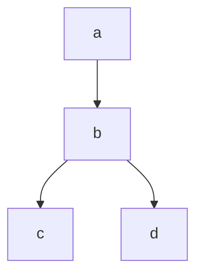

# lightweight-dag

Python library for defining, validating, and executing directed acyclic graphs
(DAGs). Operations are registered Python functions. DAGs can be loaded from
YAML or dictionaries, grouped into named suites, and executed for only the
requested outputs.

Requires Python 3.11 or later.

## Installation

Install the published package from PyPI with uv:

```bash
uv add lightweight-dag
```

To install the development and test dependencies when working from a clone of
the repository:

```bash
uv sync --group dev
```

The public API is available from the package root:

```python
from lightweight_dag import Dag, DagExecutionResult, DagSuite, Node, dag_node
```

## Registering operations

Operations must be synchronous functions defined at module level. Passing one
argument to the decorator registers a global operation:

```python
from lightweight_dag import dag_node


@dag_node
def normalize(values):
    return [value.strip().lower() for value in values]
```

The operation ID defaults to the function name. To register an operation under
a different ID, pass that ID to the decorator:

```python
@dag_node("normalize_customer_names")
def clean_customer_names(names):
    return [name.strip().title() for name in names]
```

Passing two arguments registers an operation for a specific DAG:

```python
from lightweight_dag import dag_node


@dag_node("example_report", "filter_orders")
def filter_monthly_orders(orders, minimum_total):
    return [order for order in orders if order["total"] >= minimum_total]
```

To use the function name as the operation ID while registering it for one DAG,
pass the DAG name by keyword:

```python
@dag_node(dag_name="customer_report")
def load_customer_profile():
    return {"name": "Ada", "plan": "Pro"}
```

This registers `load_customer_profile` only in the `customer_report` scope.
A function can also have a different operation ID in a DAG scope by passing
both names positionally, as in the `filter_orders` example above.

A DAG without `name` looks up only global operations. A named DAG looks up only
operations registered for that name; there is no fallback to the global scope.
The same operation can therefore have different implementations in different
scopes. Registering an operation twice in the same scope is an error.

## Defining and running a suite

A YAML suite maps DAG names to DAG definitions. A `Node.inputs` entry can refer
to another node in the same DAG or to an external input supplied to `run`.
Source nodes have no inputs and produce their values through their registered
operation. The block-style suite example in [examples/dags.yaml](examples/dags.yaml)
defines both `monthly_report` and `sales_audit`; the following code loads and
executes both DAGs.

Register each operation in the scope of the DAG that uses it. The same
operation ID can have different implementations in different DAG scopes:

```python
from pathlib import Path

from lightweight_dag import DagSuite, dag_node


@dag_node("monthly_report", "load_orders")
def load_monthly_orders():
    return [{"total": 75}, {"total": 35}]


@dag_node("monthly_report", "filter_orders")
def filter_monthly_orders(orders, minimum_total):
    return [order for order in orders if order["total"] >= minimum_total]


@dag_node("monthly_report", "summarize_orders")
def summarize_monthly_orders(eligible_orders):
    return {"count": len(eligible_orders)}


@dag_node("sales_audit", "load_orders")
def load_audit_orders():
    return [{"total": 75}, {"total": 35}]


@dag_node(dag_name="sales_audit")
def calculate_total(orders):
    return sum(order["total"] for order in orders)


@dag_node(dag_name="sales_audit")
def classify_total(total, review_threshold):
    return "review" if total >= review_threshold else "ok"


suite = DagSuite.from_yaml(Path("examples/dags.yaml").read_text())
monthly_report = suite["monthly_report"]
sales_audit = suite["sales_audit"]

report_result = monthly_report.run(outputs=["summary"])
audit_result = sales_audit.run(outputs=["audit_result"])

assert report_result.results["summary"] == {"count": 1}
assert audit_result.results["audit_result"] == "review"
```

The operation registry is scoped: `monthly_report` cannot use operations
registered only for `sales_audit`, and named DAGs do not fall back to global
operations. The YAML key supplies the DAG name; an explicit `name` field is
optional, but if present it must match the key. `suite[name]` raises `KeyError`
for an unknown name.

`DagSuite.from_dict(...)` accepts the same name-to-definition mapping. For a
single DAG, use `Dag.from_yaml(...)` or `Dag.from_dict(...)`. You can also
build one directly from `Node` instances:

```python
from lightweight_dag import Dag, Node, dag_node


@dag_node
def make_number():
    return 21


@dag_node
def double_number(number):
    return number * 2


dag = Dag(
    nodes=[
        Node(node_id="number", operation="make_number"),
        Node(
            node_id="answer",
            operation="double_number",
            inputs=["number"],
        ),
    ]
)
result = dag.run(outputs=["answer"])
assert result.results["answer"] == 42
```

To load a single DAG from YAML, register its global operations and pass the
YAML document to `Dag.from_yaml(...)`:

```python
from lightweight_dag import Dag, dag_node


@dag_node
def yaml_source(): return 21


@dag_node
def yaml_double(number): return number * 2


dag = Dag.from_yaml("""{nodes: [
{node_id: number, operation: yaml_source},
{node_id: answer, operation: yaml_double, inputs: [number]}
]}""")
assert dag.run(outputs=["answer"]).results["answer"] == 42
```

## Inputs and execution

Call `Dag.run()` with no arguments to execute every node. To execute only
selected outputs and their dependencies, pass their IDs in `outputs`. Each
operation receives its predecessor node results and the YAML `params` as
keyword arguments. Argument names correspond to predecessor IDs or parameter
keys. Inputs that don't match a node ID are external inputs and are supplied
as keyword arguments to `run`, for example `dag.run(elem2=value)`.

```python
all_results = monthly_report.run()
assert set(all_results.results) == {"orders", "eligible_orders", "summary"}

summary_result = monthly_report.run(outputs=["summary"])
assert summary_result.results["summary"] == {"count": 1}

# Reuse an already computed value instead of running its source node again.
preloaded_orders = [{"total": 75}, {"total": 35}]
summary_result = monthly_report.run(orders=preloaded_orders, outputs=["summary"])

if summary_result.status:
    print(summary_result.results["summary"])
```

Keyword arguments to `run` can provide either external input values or
precomputed values keyed by node ID. A precomputed node's operation and its
ancestors are skipped; downstream nodes receive the supplied value as usual.
External inputs are checked when `run` executes a path that requires them;
missing values or undeclared input names raise `ValueError`.

To observe nodes as they finish, pass callbacks with `listeners`. Each callback
receives a `NodeExecutionResult` containing the `node_id`, a boolean
`result` indicating success, and the node's `value` (`None` on failure). The
optional `dag_name` identifies the DAG scope. Events are emitted in execution
order, including for precomputed and skipped nodes. Exceptions raised by
listeners propagate to the caller.

```python
from lightweight_dag import NodeExecutionResult


def report_node(event: NodeExecutionResult) -> None:
    outcome = "ok" if event.result else "failed"
    dag_name = event.dag_name or "dag"
    print(f"[{dag_name}] {event.node_id}: {outcome} -> {event.value!r}")


summary_result = monthly_report.run(
    outputs=["summary"],
    listeners=[report_node],
)
```

An unknown output raises `ValueError`. The result contains `status` and
`results`; `results` contains the computed node values. With `outputs=[]`, no
nodes are executed and `results` is empty. Omitting `outputs` is different:
all nodes are selected, including independent branches.

Shared predecessors are computed only once, and nodes outside the requested
paths are not executed. In this graph, requesting only `d` computes `a`, `b`,
and `d`; `c` is not executed:



```python
from lightweight_dag import Dag, Node, dag_node


@dag_node
def get_a():
    return "a"


@dag_node
def make_b(a):
    return f"{a}->b"


@dag_node
def make_c(b):
    return f"{b}->c"


@dag_node
def make_d(b):
    return f"{b}->d"


dag = Dag(
    nodes=[
        Node(node_id="a", operation="get_a"),
        Node(node_id="b", operation="make_b", inputs=["a"]),
        Node(node_id="c", operation="make_c", inputs=["b"]),
        Node(node_id="d", operation="make_d", inputs=["b"]),
    ]
)
result = dag.run(outputs=["d"])

assert result.results == {
        "a": "a",
        "b": "a->b",
        "d": "a->b->d",
}
assert "c" not in result.results
```

If an operation raises an exception, its result and the results of its
dependent nodes become `None`, and `status` becomes `False`. Requested,
independent branches continue to execute. This example demonstrates the
failure result:

```python
from lightweight_dag import Dag, dag_node


@dag_node
def always_fail(): raise RuntimeError("operation failed")


@dag_node
def consume_result(value): return value


failure_dag = Dag.from_dict(
    {
        "nodes": [
            {"node_id": "failed", "operation": "always_fail"},
            {
                "node_id": "dependent",
                "operation": "consume_result",
                "inputs": ["failed"],
            },
        ]
    }
)
failure_result = failure_dag.run(outputs=["dependent"])
assert failure_result.status is False
assert failure_result.results["failed"] is None
assert failure_result.results["dependent"] is None
```

## Validation and security

Loading validates that node IDs are unique, every dependency refers to an
existing node, the graph is acyclic, and operations are registered in the
correct scope. It also rejects unknown fields and duplicate YAML keys. When a
node input and a parameter have the same name, the computed input takes
precedence. `params` values must be strings or numbers. `Node`, `Dag`, and
`DagSuite` definitions, including their collections, are immutable after
validation; `DagExecutionResult` contains the results of an individual
execution.

Topological sorting uses Kahn's algorithm with $O(V+E)$ complexity, where $V$
is the number of nodes and $E$ is the number of dependencies. Execution sorts
only the subgraph needed for the requested outputs.

YAML definitions can invoke Python functions registered by the application.
Only load and execute configurations from trusted sources.

## Testing and building

```bash
uv run pytest
uv build
```

`pytest` automatically measures line and branch coverage for the entire
package. To run an individual test without coverage, use
`uv run pytest --no-cov ...`.
